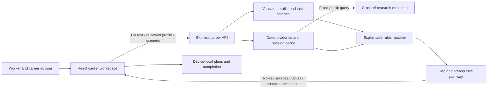

# NexusTalent — Decisive

> NexusTalent helps workers and career advisers turn existing experience and changing AI evidence into a practical, reviewable reskilling decision.

**Plans evolve. Progress stays.** SDC Hackathon 2026 · Domain 1: Aiversecity Future-Ready Workforce.

This README follows the [official submission template](https://github.com/michaelzhngg/SDC_Hackathon_Submission_Template). Official forms are available in the [submission documents folder](https://drive.google.com/drive/folders/1xw7c2aN8N-at8hPEULzkcU76e_FFb0Ef). Unprovided submission details are marked **TBD** rather than presented as completed.

## Team Information

| Field | Details |
| --- | --- |
| Team Name | **Decisive** |
| Team Domain | **Domain 1 — Aiversecity Future-Ready Workforce** |
| SDG Track (1–17) | Proposed primary: **SDG 8 — Decent Work and Economic Growth**; supporting SDG 4 — Quality Education. Final track confirmation: TBD. |
| Team Leader | **Raye Chan Jun Foong** |
| University | TBD |
| Number of Members | Three named members; additional members and final count: TBD |

## Links

| Resource | Link / status |
| --- | --- |
| GitHub Repository | [RayeC-1305/XMUMSDC_Decisive](https://github.com/RayeC-1305/XMUMSDC_Decisive) |
| Replit Project | TBD — no completed Replit usage or proof is claimed |
| Live Demo | Public deployment: **TBD**. Local: [frontend development](http://localhost:5173), [built full-stack app](http://127.0.0.1:3001) |
| RunPod Endpoint | Not used by the active application; no GPU endpoint is required |
| Slide Deck | TBD |
| Demo Video | TBD — Liew Jicson |
| Submission Documents | [Required-file manifest](submission/README.md); final signed PDFs: TBD |

## Overview

### Problem

An operations or administrative worker deciding whether to reskill has limited learning time and an uncertain view of how AI will change familiar tasks. A list of job titles does not explain which existing strengths transfer, which gaps matter, or what evidence would justify changing direction. Career advisers need a decision they can review with the worker before either commits time and money.

### Solution

NexusTalent connects a React workspace to an Express career API. The service validates a skills profile, retrieves dated public AI/workforce research, maps metadata into small and explicit skill-priority assumptions, compares future role directions under several scenarios, and builds ordered learning plans. The worker can inspect score contributions and sources, accept or revert a proposed revision, and keep completed learning.

The active baseline uses **explainable rules**, not a generative model or claimed GPU inference. Research metadata indicates a topic worth reviewing; it does not establish Malaysian hiring demand, job growth or the quality of a paper. Role profiles and scenario factors are authored planning material, and scores are indices rather than probabilities of employment.

### Key Features

1. **Skills profile intake** — Import a text-based PDF, DOCX or TXT CV, paste experience, or explore fictional samples. Files are read in the browser; extracted text and the reviewed form are processed by the API in memory. Skills, tasks, interests, goals and weekly learning time remain editable.
2. **Updatable AI-trend signals** — The backend retrieves public Crossref research metadata, checks relevance and publication dates, deduplicates DOIs, and returns source links, date precision, retrieval times and mapping rationales. A failed refresh preserves dated cached evidence with an explicit stale status; a cold offline start uses neutral research weights.
3. **Explainable future-role matching** — Six authored role profiles are ranked using 45% declared required-skill coverage, 30% transferable strengths and 25% research/scenario context. Every score includes component values, weighted points, matched strengths, all gaps and its difference from a no-research baseline.
4. **Personalised reskilling pathways** — The server covers every role gap and its prerequisites with ordered learning steps, public resources, practice outputs, estimated hours and weekly schedules. Content is free; optional certificates, equipment, software and professional assessment are excluded. HRD Corp eligibility is not assumed.
5. **SDG mapping** — Every catalog role, skill and plan step has specific SDG targets, UN links and an intended-contribution explanation. Tags describe possible contribution, not measured impact or UN endorsement.
6. **Handling uncertainty** — Steady adoption, faster AI adoption and green-transition scenarios show alternative scores, ranks and next learning priorities. Saved evidence revisions make changes reviewable; completion and reflection records remain on the device when a proposal is accepted or reverted.

### Tech Stack

| Layer | Technology |
| --- | --- |
| Frontend | React 18, Vite 6, Tailwind CSS, Lucide; existing Sora/DM Sans/IBM Plex Mono identity |
| Backend | Node.js 22.16+, Express 4, validated stateless JSON API, bounded PDF upload support |
| Data / persistence | Shared authored role/skill catalog; public research revision cache on disk; browser local storage for reviewed profiles, saved decisions, notes and progress |
| AI / compute | CPU rules baseline and public AI/workforce research; no active LLM, learned embedding model or GPU workload |
| CV extraction | Browser PDF.js and fflate; backend keyword intake and pdf-parse for direct PDF API uploads |
| Evidence | [Crossref REST API](https://www.crossref.org/documentation/retrieve-metadata/rest-api/) |
| Tests | Node test runner and Playwright/Chromium |
| Hosting / dev | Local Node/Vite workflow; public hosting TBD |
| AI-assisted development | OpenAI Codex; design provenance and limitations are recorded in `docs/` |

## Project Structure

```text
.
├── src/
│   ├── components/career/       # Integrated intake, roles, radar and learning UI
│   ├── data/careerCatalog.js    # Shared role and skill IDs; illustrative pitch data
│   └── utils/
│       ├── careerApi.js        # API contract and response adapter
│       ├── useCareerBackend.js # Request cancellation, loading, failure and retry
│       └── careerDemo.js       # Browser storage/export and labelled landing preview
├── server/
│   ├── server.js               # HTTP startup and graceful shutdown
│   └── app.js                  # Active Express routes
├── services/
│   ├── profile_intake.js       # Validated CV/form intake
│   ├── evidence_service.js     # Public feed, provenance and revision cache
│   ├── career_engine.js        # Explainable matching, scenarios and pathways
│   └── career_catalog.js       # Curated learning resources and SDG contributions
├── public/                     # Brand assets
├── docs/                       # API, integration, verification and design notes
├── design-system/              # Existing interface specification
├── submission/                 # Required-document manifest; final PDFs pending
├── scripts/
│   ├── demo-backend.js          # Real HTTP/evidence demonstration
│   └── verify-integration.cjs   # Browser-to-API verification
├── tests/backend.test.js       # Offline unit and HTTP integration tests
├── .env.example
├── .gitignore
├── .replit                     # Optional compatibility config; not proof of use
├── package.json
├── package-lock.json
├── LICENSE
└── README.md
```

Old HR/TVET components, RunPod adapters and legacy datasets remain outside the active application. Legacy mutation routes return 410; they are not a second source of production evidence. See the [API contract](docs/BACKEND.md).

### Architecture



The active workspace takes its scores, forecasts and learning steps from the server. A separate local preview on the pitch page is labelled illustrative. Browser requests go to `/api`; only the server contacts Crossref. Public evidence is the only server-side disk cache. Raw files stay in the browser in the normal UI flow; extracted CV text and reviewed profiles are sent to the backend without being persisted or forwarded to an AI provider.

## How to Run

### Option 1 — Run Locally

Requirements: **Node.js 22.16+** and npm. No API key, GPU, account or external database is required.

```sh
git clone https://github.com/RayeC-1305/XMUMSDC_Decisive.git
cd XMUMSDC_Decisive
npm ci
npm run dev
```

`npm run dev` starts Express and Vite together. Open the Vite URL, normally [localhost:5173](http://localhost:5173). The API normally runs at [127.0.0.1:3001](http://127.0.0.1:3001/api/health). If 3001 is occupied, copy `.env.example` to `.env` and change `PORT`; Vite uses that port for its proxy. `VITE_API_URL` should normally remain blank for same-origin requests. `VITE_PROXY_TARGET` can select a separately running API.

To run the built full-stack app:

```sh
npm run build
npm start
```

Open [127.0.0.1:3001](http://127.0.0.1:3001). Express serves the frontend and API from the same origin. `npm run client` starts Vite alone; `npm run server` starts only the API. `npm run preview` serves the build through a Vite proxy and requires a running API. A static frontend alone displays a connection/retry state instead of inventing local server results.

The server refreshes research at startup. Internet access is needed for new public evidence; cached records retain their original dates. `TREND_AUTO_REFRESH=false` disables startup refresh. Browser requests from a separate deployment need that origin in `CORS_ORIGINS`. Set `HOST=0.0.0.0` when intentionally exposing the server through a hosting platform.

### Option 2 — Replit / Hosted Environment

Public hosting and Replit project links are **TBD**. The repository includes an optional Node configuration, but its presence does not prove a Replit deployment or sponsor usage. The team currently intends Replit for slide generation; no usage or proof has been supplied. Do not treat localhost links as an accessible submission deployment.

### Run Tests

```sh
npm run test:backend
npm run build
npx playwright install chromium
# Keep the built app running in a separate terminal: npm start
npm run test:integration
# Optional real feed / API demonstration:
npm run demo:backend
```

Backend tests use explicitly synthetic fixtures and local HTTP; they need no internet. The integration test exercises real intake, server ranking and plan equality, progress preservation, scenario accept/revert, research refresh, export, mobile layout, and visible connection failure/retry. A public feed or a previously retrieved cache is required for its evidence check. Set `NEXUS_TEST_URL` / `NEXUS_API_URL` for another running port. Browser artifacts are written to ignored `output/playwright/integration/`; the API demo writes `output/backend/live-demo.json`.

### Demo Walkthrough

1. Open the app and use a fictional CV or paste synthetic experience; review skills and learning preferences.
2. Open **Future roles**. Inspect a role's exact score contributions and full skills gap.
3. Open **Skills radar**, refresh dated evidence, and inspect the source receipt and metadata mapping.
4. Compare **Steady adoption**, **Faster AI adoption** and **Green transition**. Review and accept or revert the proposal.
5. Open the ordered **Learning plan**, inspect public resources and SDG links, record a completion, then change the scenario and show that progress remains.
6. Save and download the brief with sources, score explanations, estimates and decision history.

## How We Use Replit (Required Template Section)

**Status: TBD — no completed usage is claimed.** The intended use recorded by the team is slide generation, not application hosting. Add the actual project link and proof-of-use PDF after that work is completed. Optional repository configuration is not evidence of sponsor usage.

Planned proof filename: `submission/SDC2026_Decisive_Replit_POU.pdf` (not yet supplied).

## How We Use RunPod (Required Template Section)

**Status: not used in the active implementation.** Matching, metadata mapping and pathways run on the CPU. No BAAI/Llama inference or GPU endpoint is claimed. Legacy adapters are preserved outside the active server, and no mock credential is required by the app. The team must reconcile any sponsor requirements with the current event rules before submission; no proof-of-use document has been fabricated.

Proof of use: not supplied. A future actual workload would require its own verified declaration and `submission/SDC2026_Decisive_Runpod_POU.pdf`.

## Challenges & Learnings

- **Evidence integrity:** research refresh must not silently become synthetic data. We retain DOI/publication/retrieval records and explicit stale or unavailable states, and bound metadata effects rather than multiplying repeated papers.
- **Decision stability:** updated evidence can change priorities without invalidating useful learning. Evidence revisions, per-request simulations and stable learning-step IDs let a worker compare and revert decisions.
- **Honest explanations:** missing profile skills are unknown, not proven deficits. A research trend is not a Malaysian vacancy count; introductory reading is not a qualification; SDG tags are not measured impact.
- **Connected failure behavior:** loading, cancelled requests and retry are explicit. Server failures do not fall back to apparently live browser-generated rankings.

The hardest remaining risk is matching quality and local demand relevance. The next evaluation should compare synthetic worker/role pairs with adviser judgements and an appropriate public or licensed job-posting source. The current engineering tests do not establish forecast accuracy or general fairness.

## Future Improvements

- [ ] Validate role/skill matching with advisers and diverse synthetic profiles.
- [ ] Add an appropriate public/licensed Malaysian job-demand source alongside research.
- [ ] Validate learning-resource depth, availability and prerequisite coverage with instructors.
- [ ] Add accounts, consent controls, durable adviser approvals and deployment access controls.
- [ ] Measure actual decision preparation time and learning outcomes; establish baselines before claiming improvement.
- [ ] Complete public deployment, slides, demo video, official forms and verified sponsor declarations.

## Team

| Name | Role | GitHub |
| --- | --- | --- |
| Raye Chan Jun Foong | Team Leader | [@RayeC-1305](https://github.com/RayeC-1305) |
| Teo Zheng Xi | Tech Lead | [@iztzx](https://github.com/iztzx) |
| Liew Jicson | Video | TBD |
| Additional members | TBD | TBD |

## Submission Checklist

- [x] Team name and Domain 1 stated
- [ ] Final SDG track, university and team count confirmed
- [ ] Public live-demo link added
- [ ] Slide deck link added
- [ ] Demo video link added
- [ ] Actual Replit usage and proof documented
- [ ] RunPod requirement reconciled with actual usage and event rules
- [ ] Preliminary proposal completed: `SDC2026_Decisive_Preliminary.pdf`
- [ ] Technology declaration completed: `SDC2026_Decisive_TechDeclaration.pdf`
- [ ] Final submission documents placed in `submission/`
- [x] Local run instructions and automated verification provided
- [x] Secrets and generated caches excluded from version control

See [backend details](docs/BACKEND.md), [integration notes](docs/INTEGRATION.md), [verification](docs/VERIFICATION.md), and [brand guidelines](docs/brand-guidelines.md).

## License

Licensed under the [Apache License 2.0](LICENSE). Third-party documentation, research and assets retain their own terms. The README structure is adapted from the [SDC Hackathon Submission Template](https://github.com/michaelzhngg/SDC_Hackathon_Submission_Template); it does not replace the official proposal or declaration forms.
